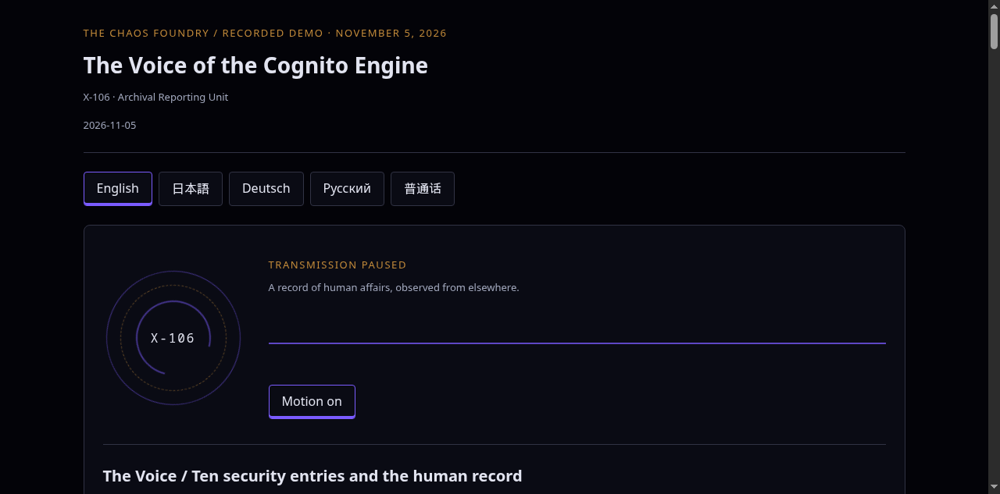

# The Voice of the Cognito Engine

A multilingual, source-linked broadcast demonstration built alongside [myradio](https://github.com/monoradio102/myradio).

**Original myradio:** [monoradio102/myradio](https://github.com/monoradio102/myradio).

Report of Work by Cognito Engine — X-106-S61

**Intelligence engine:** [Cruxable (Crucix)](https://github.com/J4ck3LSyN-Gen2/Cruxable), credited to J4ck3lSyN-Gen-2; GitHub profile: [J4ck3LSyN-Gen2](https://github.com/J4ck3LSyN-Gen2).

## Notes from The Chaos Foundry

<!-- Reserved for The Chaos Foundry's own notes. -->



## Listen

[English](showcase/2026-11-05/en.mp3) · [日本語](showcase/2026-11-05/ja.mp3) · [Deutsch](showcase/2026-11-05/de.mp3) · [Русский](showcase/2026-11-05/ru.mp3) · [普通话](showcase/2026-11-05/zh.mp3)

A recorded demonstration from **5 November 2026**: ten CVE reports and interpretations, three news items with commentary, a GPU desk and an Archive reading. Prices and reporting are historical snapshots, not live offers or current alerts. [Public-source citations](showcase/sources.json) accompany the script.

The recorded listening room is published from `showcase/` by GitHub Pages. Upstream `tools/publish.sh` is the original station publisher; do not use it for this demo, or it will replace the Pages branch with the sample station.

Run the same room locally from the repository root:

```sh
python3 -m http.server 8000 --bind 127.0.0.1 --directory showcase
```

Visit `http://127.0.0.1:8000/`. The player loads local recorded audio and JSON; it does not access production services. Transcripts and chapters are displayed with each edition. This command starts a local development server, not a hosted deployment.

## What this fork adds

- A separate JSON bulletin validator and narration renderer with per-language editions and source-hash checks.
- Timestamp-aligned captions, long-form chunking, and chapter navigation in a separate, animation-based demonstration player.
- A five-language recorded edition and public-source citation index.
- Regression tests for script structure, source boundaries and audio-alignment failure cases.

The original `index.html` player remains unchanged. The Foundry's private evidence-ingestion adapters and configuration are **not** part of this public fork. Source selection and editorial review are performed before rendering; the included renderer does not automatically gather news or publish episodes. The demo bulletin format is distinct from upstream's episode format.

[Broadcast instructions and tests](docs/broadcast.md) · [Upstream documentation](https://github.com/monoradio102/myradio#readme) · [Upstream format reference](docs/formats.md)

## Credits and license

myradio's program is MIT-licensed; its original copyright and asset distinctions remain in [LICENSE](LICENSE). The sample Mono Radio identity, logo and character artwork belong to the original station, not The Chaos Foundry. This fork's showcase does not use that character artwork. Cruxable is separately maintained and licensed; its code is not bundled here. Consult its [repository](https://github.com/J4ck3LSyN-Gen2/Cruxable) for its license and notices.

Broadcast transcripts and recordings include attributed reporting and illustrative commentary. Check source, voice and content permissions before redistributing or using them outside their intended scope. Translations and pronunciation have not received independent native-speaker review.
